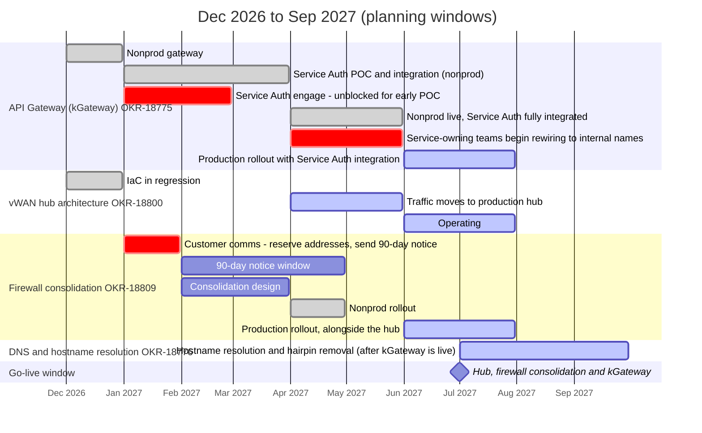

# aiR Network Re-architecture Timeline

Milestones, go-live window, and when teams are unblocked. Objective: [OKR-18774](https://jira.kcura.com/browse/OKR-18774).

> **Windows shown below are intended for planning, not committed dates.** Dates should not be communicated as hard dates to customers; they are intended to forecast team-dependency timelines for beginning work.

Interactive version: [aiR Network Timeline (Claude artifact)](https://claude.ai/artifact/9rFrbMoUq7R1khxdxDkZR2)

## Timeline

Legend for the chart: light bars are nonprod or deliverable windows, blue bars are production or live windows, red bars are where another team has to engage, unstyled bars are design or waiting windows.

## Windows by initiative

| Initiative | Dec 2026 | Jan | Feb | Mar | Apr | May | Jun | Jul | Aug | Sep |
|---|---|---|---|---|---|---|---|---|---|---|
| **API Gateway (kGateway)** [OKR-18775](https://jira.kcura.com/browse/OKR-18775) | Nonprod gateway | Service Auth POC and integration | ← | ← | Nonprod live, Service Auth fully integrated | ← | **Production rollout** with Service Auth integration | ← | | |
| **vWAN hub architecture** [OKR-18800](https://jira.kcura.com/browse/OKR-18800) | IaC in regression | | | | Traffic moves to production hub | ← | **Operating** | ← | | |
| **Firewall consolidation** [OKR-18809](https://jira.kcura.com/browse/OKR-18809) | | Customer comms: reserve addresses, send 90-day notice | Consolidation design · notice window | ← | Nonprod rollout · 90-day notice window complete | | **Production rollout**, alongside the hub | ← | | |
| **DNS and hostname resolution** [OKR-18776](https://jira.kcura.com/browse/OKR-18776) | | | | | | | | **Hostname resolution and hairpin removal**, after kGateway is live | ← | ← |

**Go-live window: June and July 2027.** The hub, firewall consolidation and kGateway production rollouts land together.

## Teams to engage, and when

| When | Team | Why |
|---|---|---|
| January 2027 | Service Auth | Unblocked for early POC once the gateway is in nonprod. |
| January 2027 | Customer comms | Reserve the per-region public address range and send the 90-day customer notice; the window completes in April, ahead of the June–July production rollout. |
| April–May 2027 | Service-owning teams | Begin rewiring services to internal names against the nonprod gateway with Service Auth integrated. |
| June–July 2027 | Service Auth | Production rollout of kGateway with Service Auth integration. |
